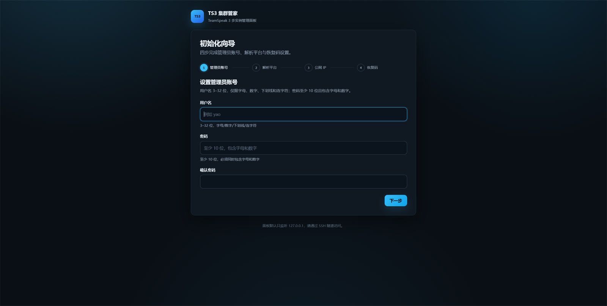
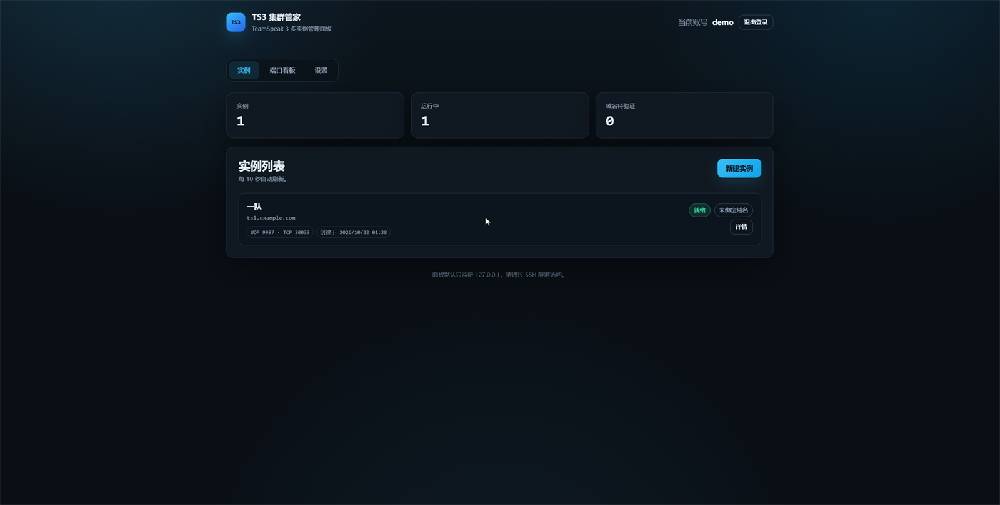
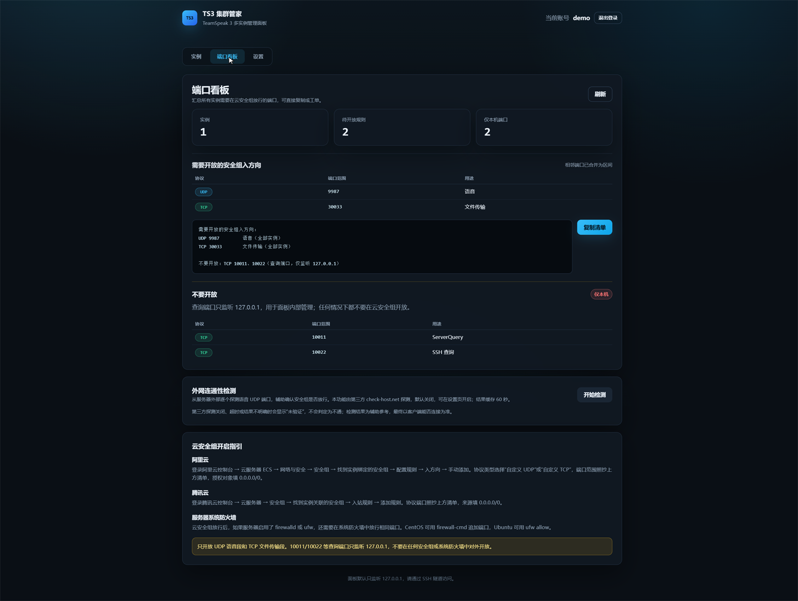
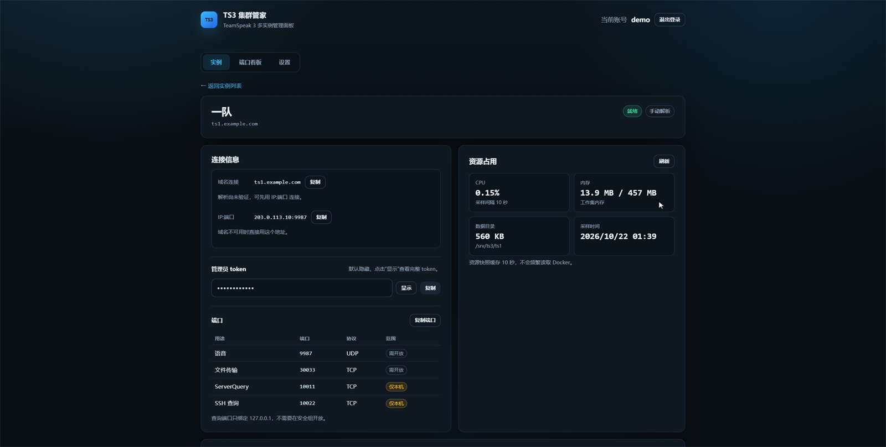

# ts3panel · TS3 集群管家

在一台 Linux 云服务器上，用 Web 页面管理多个 TeamSpeak 3 Docker 实例：自动分配端口、绑定域名（A + SRV）、查看状态、备份恢复。单二进制、无外部数据库、无 CDN、默认只监听回环。

> 适合自用与小圈子：一个管理员账号，一台机器，多个独立 TS3。项目以 MIT 协议开源，可自部署、可二次开发。

---

## 截图

| 初始化向导 | 实例列表 |
| --- | --- |
|  |  |

| 端口看板 | 实例详情 |
| --- | --- |
|  |  |

截图中的域名、IP、token 均为示例数据，不代表任何真实部署。

---

## 能做什么

- **3 步建实例**：填名称和子域名 → 自动分配 4 个端口、建目录、起容器、抓管理员 token。
- **域名自动化**：Cloudflare、阿里云 DNS、DNSPod 一键写 A + SRV；不支持或失败时给可照抄的手动清单。
- **端口看板**：汇总需要在安全组放行的 UDP / TCP 区间，一键复制成工单文本。
- **状态与详情**：容器状态、最近日志（脱敏）、CPU / 内存快照、数据目录大小。
- **备份恢复**：手动备份 / 恢复、跨机器还原、可配置的自动备份计划与保留份数。
- **安全默认值**：只绑 `127.0.0.1:8899`、只操作带 `ts3panel.managed=true` 标签的容器、Query 端口只绑回环、写接口校验 `X-Requested-With`。

明确**不做**：在线人数 / 频道管理、公网 HTTPS、实例克隆、安全组自动化、多租户注册、Windows 宿主机。

---

## 3 分钟安装

### 环境要求

| 项 | 要求 |
| --- | --- |
| 系统 | Debian 11+、Ubuntu 22.04（amd64 或 arm64） |
| 权限 | root（面板需要访问 Docker socket） |
| Docker | Docker Engine 24+，`systemctl start docker` 可用 |
| 网络 | 能访问 GitHub Releases；不能时用 `--from-file` 离线安装 |
| 端口 | 面板只监听 `127.0.0.1:8899`；TS3 使用 `9987+i/udp`、`30033+i/tcp`，Query 端口只绑回环 |

> 本版本在 Debian 12 与 Debian 11 上完成安装 / 初始化 / 实例 / 备份恢复 / 重启恢复验证；
> Ubuntu 22.04 是目标平台，但未在本次发布环境复测。

### 一条命令

```bash
curl -fsSL https://raw.githubusercontent.com/yaodooo/ts3panel/main/scripts/install.sh | sudo bash
```

> 仓库地址为 `yaodooo/ts3panel`。如果你 fork 到自己的账号，请把 URL 换成你的仓库，
> 或保留脚本并用 `--repo 你的账号/ts3panel`。

脚本会：检查 root / systemd / Docker → 下载对应架构二进制 → 建 `/etc/ts3panel`（0700）→
生成 `config.toml`（随机密钥，root:root 0600）→ 安装 systemd unit（`User=root` + 沙箱）→
启动服务 → 打印初始化入口。重复执行是安全的：会升级二进制并重启服务，不会覆盖配置和状态。

### 打开面板

面板默认只绑回环，请在**本机**建 SSH 隧道（不要直接把 8899 暴露到公网）：

```bash
ssh -L 8899:127.0.0.1:8899 root@<服务器公网 IP>
# 然后浏览器打开 http://127.0.0.1:8899/setup
```

初始化入口只在首次初始化前有效；完成初始化后再次访问会返回 `E_SETUP_DONE`。
忘记密码时在服务器执行 `ts3panel reset-password`，会生成 5 分钟有效的一次性重置链接。

### 离线 / GitHub 不通

```bash
# 在能上网的机器下载 Release 包（含二进制、LICENSE、README、示例配置）
# ts3panel_1.0.0_linux_amd64.tar.gz

# 上传到服务器后：
sudo bash scripts/install.sh --from-file ./ts3panel_1.0.0_linux_amd64.tar.gz
```

`--from-file` 也可以直接传裸二进制。安装脚本本身可从仓库 `scripts/install.sh` 提前拷过去。
如果只是 GitHub 下载慢，可用镜像前缀：

```bash
sudo TS3PANEL_GITHUB='https://<你的 GitHub 镜像>' bash scripts/install.sh
```

> 测试机准备脚本 `scripts/test-setup.sh` **仅用于测试机**（装 Docker、内存不足 2 GiB 时加 swap、建测试目录）。
> 生产环境请用 `install.sh`。

---

## 第一次使用

1. 打开初始化向导：设置管理员用户名 / 密码（≥10 位，字母 + 数字）。
2. 选择解析平台，或点「先跳过」走手动解析。
3. 填公网 IP。自动探测失败不阻塞流程；**手填值优先**，NAT 云主机请务必手填。
4. 保存 8 个一次性恢复码（只显示一次，确认已保存后才能完成）。
5. 进入面板 → 「新建实例」→ 填名称与子域名 → 等待四步进度完成（建容器 → 抓密钥 → 写解析 → 验证）。
6. 按端口看板去云控制台放行 UDP 语音段和 TCP 文件传输段；**不要**开放 Query 端口。

解析平台保存规则：同一平台 + 同一主域名只有一个配置，**再次保存会覆盖现有凭据**，不会新增账号。
这条在设置页也有提示。

---

## 与现有工具的差异

| 能力 | ts3panel | s1oopX 一键脚本 | Portainer | ts3-manager |
| --- | --- | --- | --- | --- |
| 多 TS3 实例编排 | 是 | 否（单实例） | 通用容器，需手工 | 否 |
| 4 端口自动错开 | 是 | 手工 | 不涉及 | 不涉及 |
| 域名 A + SRV 自动写入 | 是（CF / 阿里云 / DNSPod / 手动） | 否 | 否 | 否 |
| 管理员 token 自动捕获 | 是 | 是（单实例） | 否 | 否 |
| 端口看板 / 安全组清单 | 是 | 部分 | 否 | 否 |
| 实例备份 / 恢复 | 是 | 否 | 通用 volume 备份 | 否 |
| 容器语义约束 | 标签白名单 + host 网络 | 脚本 | 通用 | 只读查询 |
| 在线人数 / 频道管理 | 不做（有意砍掉） | 否 | 否 | 是 |

设计上借鉴了 s1oopX 脚本的安全基线（Query 只绑回环、非 root 运行 TS3、国内源降级），但不复用其代码。

---

## 配置说明

安装脚本生成 `/etc/ts3panel/config.toml`，完整示例见 [`config.example.toml`](config.example.toml)。

| 字段 | 说明 |
| --- | --- |
| `listen` | 面板监听地址，默认 `127.0.0.1:8899`。改成 `0.0.0.0` 前请自行加 HTTPS 反向代理。 |
| `instance_root` | 实例数据根目录，默认 `/srv/ts3`；每个实例一个子目录，备份在 `.backups/`。 |
| `session_secret` | 64 字节 hex，首次启动自动生成。 |
| `master_key` | 32 字节 hex，加密 Provider 凭据；已有 Provider 时不可丢失。 |
| `[[providers]]` | 解析平台配置，按「平台 + 主域名」唯一；凭据以 AES-GCM 密文保存。 |
| `[limits]` | `max_instances`、每实例内存 / CPU、记录 TTL。 |
| `[backup]` | 自动备份开关、模式、时间、保留份数。 |
| `[ports]` | 第三方端口探测开关与缓存时间。 |

修改 `instance_root` 后，若使用 systemd，请同步调整 unit 的 `ReadWritePaths`（安装脚本会按配置生成）。

`config.toml` 属主 `root:root`、权限 `0600`；`/etc/ts3panel` 权限 `0700`。面板以 root 运行是
因为 Docker socket 本身就是 root 等价权限（见勘误 E4），systemd unit 用 `ProtectSystem=strict`、
`ProtectHome=true`、`PrivateTmp=true`、`ReadWritePaths` 等把可写范围限制在配置、状态和实例目录。

---

## 数据、备份与恢复

```text
/srv/ts3/
├── <instance-id>/
│   ├── ts3server.sqlitedb
│   ├── files/
│   ├── logs/
│   └── .panel.json
└── .backups/
/etc/ts3panel/config.toml
/var/lib/ts3panel/state.json
/var/lib/ts3panel/audit.log
```

- 备份包包含身份密钥、SQLite 数据库和 `files/`，可在另一台 Docker 主机还原，客户端收藏仍然有效。
- **从备份恢复后管理员 token 不会恢复**：备份里不保存 token。需要在 TS3 客户端重新获取，或按需手动设置。
- **手动备份不参与滚动清理**；只有自动备份会按 `retention` 删除旧包。面板会显示每份备份的占用空间，
  便于你自行判断和清理。
- 恢复前会先停止容器；解压失败会回滚原目录。磁盘不足时备份直接失败，不产生半成品包。

详见 [备份与恢复](docs/backup-restore.md)。

---

## 安全模型

- 面板默认只监听回环，推荐 SSH 隧道；不内置 HTTPS / 反向代理。
- 只操作带 `ts3panel.managed=true` 标签的容器；删除前会再次校验标签。
- 所有写接口要求 `X-Requested-With: ts3panel`；会话 Cookie 为 `HttpOnly` + `SameSite=Strict`。
- Provider 凭据 AES-GCM 加密存储，界面掩码；日志对 token / 密码 / 密钥统一打码。
- TS3 的 ServerQuery（`10011+i`）和 SSH Query（`10022+i`）只绑 `127.0.0.1`，端口看板不会提示开放。
- 无默认账号；初始化必须由本机访问或携带 `setup_token`。

发现安全问题请勿公开 Issue，请私下联系维护者，不要在公开渠道贴出凭据或可利用细节。

---

## 常见问题

### Cloudflare 开了橙云，语音连不上

TS3 走 UDP，Cloudflare 橙云只代理 HTTP/HTTPS，不代理 UDP。面板写入 A 记录时强制
`proxied=false`（灰云），SRV 的 target 也不能是橙云记录。如果之前手工开过橙云，请在
Cloudflare 控制台改回灰云后再验证。

### 云主机是 NAT，客户端看到的是内网 IP

在向导或设置页**手填**公网 IP，手填值优先于自动探测；探测失败不会阻塞流程。NAT 场景下
文件传输可能仍需要修正 `filetransfer_ip`，可在实例详情页按提示处理。

### 国内服务器开 80/443 要备案吗

面板默认只监听 `127.0.0.1:8899`，通过 SSH 隧道访问，不需要 80/443，也不涉及备案。
只有你自己把面板暴露到公网 80/443 时才涉及备案与 HTTPS 配置，这不在本项目范围内。
TS3 使用 UDP 9987 等端口，一般不属于网站备案的 80/443 范畴，具体以云厂商要求为准。

### 免费版 32 槽位不够用

这是 TeamSpeak 官方非商业许可的限制，面板不做绕过。页面对上限有提示；需要更多槽位请购买授权。

### 第三方端口探测为什么总显示「未知」

该功能默认关闭。开启后由面板请求 **check-host.net** 做外部探测；服务器访问不到该服务、
或探测结果不明确时，一律显示「未知」，**不会**把「没探测到」显示成「不通」。这是可选功能，
不影响创建、绑定和连接；最终以 TS3 客户端能否连接为准。结果缓存 60 秒，可在 `[ports]` 调整。

### 为什么手动备份一直不自动删除

按设计，手动备份不参与滚动清理，避免误删你特意留下的包；只有自动备份按 `retention` 删除。
面板会显示每份备份的占用空间，便于你自行判断和清理。

### 恢复后管理员 token 去哪里了

备份包不保存 token（token 属于首次启动日志，且可能已被使用）。恢复后请在 TS3 客户端重新获取
Server Admin，或通过客户端权限系统重新生成 Privilege Key。实例身份密钥已随备份恢复。

### 忘记管理员密码 / 恢复码全丢了

在服务器执行：

```bash
ts3panel reset-password
```

生成 5 分钟有效的一次性链接，可重设用户名密码并重新生成恢复码。需要 root 权限。

### 端口被占用 / 实例起不来

端口分配会同时试 TCP 和 UDP，被占用就自动跳到下一个 `i`；连续 50 组都失败会返回
`E_PORT_EXHAUSTED`。先看 `ss -lntup` 与实例详情里的日志，不要停止机器上的其他服务。

更多排错见 [排错手册](docs/troubleshooting.md)。

---

## 从源码构建 / 开发

```bash
# Go 1.22+，仅允许 docker/docker、x/crypto、BurntSushi/toml 三个直接依赖
go build ./...
go vet ./...
go test ./...

# 交叉编译（发布包同款）
CGO_ENABLED=0 GOOS=linux GOARCH=amd64 go build -trimpath \
  -ldflags "-s -w -X main.version=1.0.0" -o ts3panel ./cmd/ts3panel
```

前端是 `web/` 下的原生 HTML/CSS/JS，通过 `embed.FS` 打进二进制；**没有构建步骤、没有 npm、没有 CDN**。
修改前端后重新 `go build` 即可。

没有 Docker 的 Windows/macOS 开发机也能启动面板查看界面，但实例相关操作会报 Docker 不可用；
发布只支持 Linux。

---

## 文档

- [部署与升级](docs/deploy.md)
- [排错手册](docs/troubleshooting.md)
- [各平台获取 DNS Token](docs/dns-tokens.md)
- [备份与恢复](docs/backup-restore.md)
- [变更记录](CHANGELOG.md)

---

## 许可证

[MIT](LICENSE)
